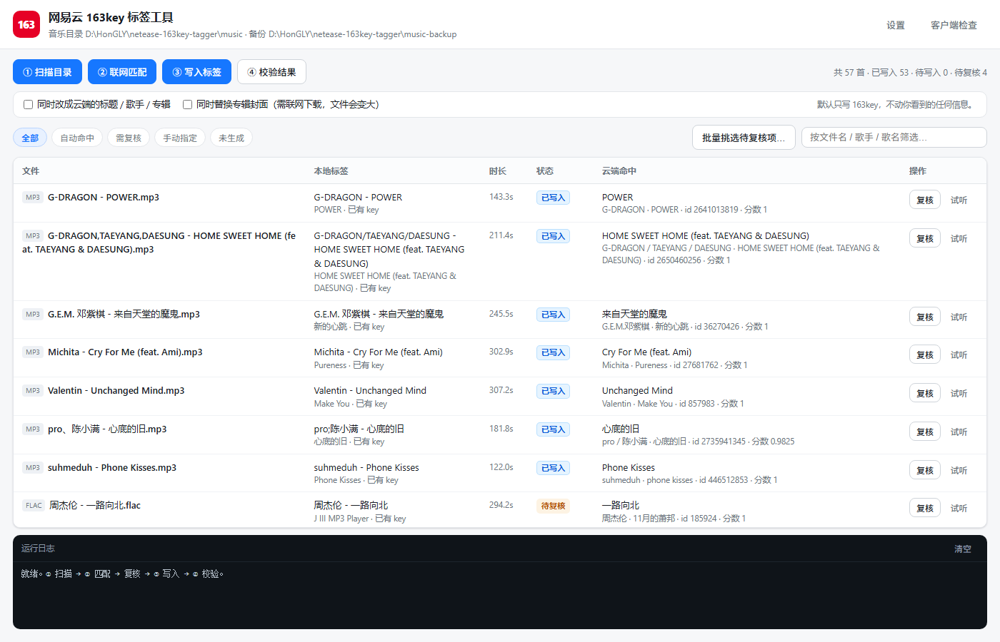

<div align="center">

# Netease 163key Tagger

**Write `163key` tags into local music files so the client recognizes which catalog track they are**

[](https://github.com/H0NG1Y/netease-163key-tagger)
[](https://github.com/H0NG1Y/netease-163key-tagger/stargazers)
[](https://github.com/H0NG1Y/netease-163key-tagger/releases/latest)
[](https://github.com/H0NG1Y/netease-163key-tagger/releases/latest)
[](https://nodejs.org)
[](package.json)

</div>



## Overview

A local-only Windows tool that scans your music files, matches them against the Netease Cloud Music catalog by "artist - title", and writes the `163 key(Don't modify)` tag into each file.

Once tagged correctly, the client treats them as ordinary catalog tracks — **they show up with proper titles and cover art in Local Music, and appear in the Downloaded list** (provided the files sit inside the directory the client scans; see below).

Nothing is downloaded, no paid content is bypassed. Only tags on files you already own are modified.

## Download

Get the latest build from [GitHub Releases](https://github.com/H0NG1Y/netease-163key-tagger/releases/latest).

- `netease-163key-tagger-vX.Y.Z.exe` — single portable executable, just double-click. Config and reports live in `%USERPROFILE%\.netease-163key-tagger`.
- From source: requires Node.js 22+, zero npm dependencies.

Each release also ships `.sha256` and `checksums.txt` so you can verify the download.

## Usage

1. Double-click the EXE; your browser opens `http://127.0.0.1:port`.
2. Open **Settings** and pick your **music folder** (gets written) and a **backup folder** (registered read-only, the tool will never write into it).
3. Click **① Scan** to read tags, duration and real bitrate.
4. Click **② Match** to search the catalog. A live progress bar shows the current file.
5. For anything uncertain, click **Review** to compare candidates side by side — audition the file, see cover art and duration deltas, or paste a song ID / share link for an exact lookup.
6. Click **③ Write tags**. Only auto-matched entries are written by default; everything else needs your explicit approval.
7. Click **④ Verify** to compare the audio payload against the backup byte for byte.

Tick the two checkboxes to also fix title / artist / album / cover art (off by default).

## Features

- MP3 (ID3v2.3 `COMM` frame) and FLAC (Vorbis comment `DESCRIPTION`, plus a `COMMENT` compatibility copy)
- Matching uses a search depth of 100 plus a three-signal decision (duration, album, catalog identity) to avoid covers and backing tracks
- Review panel shows cover thumbnails, official/UGC badges and duration deltas; supports lookup by ID or share link
- Batch re-pick for pending items, with a confirmation list before anything is applied
- In-place writes whenever the new tag fits the existing padding — audio bytes stay untouched
- Optional metadata rewrite for title, artist, album and cover art (`--meta` / `--cover`)
- Dry-run by default; nothing is written without explicit confirmation
- Backup folder is registered read-only with segment-aware path checks
- Zero npm dependencies, Node built-ins only

## About the "Downloaded" state

`163key` is just a metadata tag telling the client which catalog track a file is. It is **not** proof of a download.

The client tracks downloads in `webdb.dat`, table `offlineTrack`:

1. A native scanner walks the **configured download folder** and hands each file's comment (the decrypted `music:{...}` payload) to the frontend;
2. The frontend takes everything before the first colon, parses it, and extracts a song ID;
3. It inserts a row into `offlineTrack` with `relativePath = absolute path − download root`.

So three conditions must hold:

| Condition | Responsible |
| --- | --- |
| The file carries a valid 163key | ✅ this tool |
| The file sits inside the configured download root | ⬜ you |
| The client has scanned that folder at least once | ⬜ restart the client |

The **Client Check** panel reads `offlineTrack` **read-only** and tells you which step is missing.

### Verified on a real machine

With all three conditions met, both directions hold: Local Music goes from blank artist/album to properly matched tracks (`library.dat`'s `tid` becomes a real song ID identical to the `musicId` inside the tag), and the Downloaded list populates (`offlineTrack` goes from 0 rows to positive).

Natural control group: files without a key keep an empty `tid` and never enter `offlineTrack`.

## Rewriting file metadata

After matching, you can also replace the visible metadata with the catalog's:

```bash
node apply.mjs apply --report out/matches.json --write --meta            # title/artist/album
node apply.mjs apply --report out/matches.json --write --meta --cover    # plus cover art
```

| Flag | What changes | Cost |
| --- | --- | --- |
| `--meta` | MP3 `TIT2`/`TPE1`/`TALB`/`TPE2`; FLAC `TITLE`/`ARTIST`/`ALBUM`/`ALBUMARTIST` | plain text, negligible size change |
| `--cover` | MP3 `APIC` frame; FLAC `PICTURE` block (single image, old one removed) | downloads art, file size changes |

Audio payload is never touched — there is a regression test for exactly that.

## CLI

```bash
node apply.mjs scan     --root ./music
node apply.mjs match    --root ./music
node apply.mjs apply    --report out/matches.json --dry-run
node apply.mjs apply    --report out/matches.json --write
node apply.mjs verify   --root ./music --backup ./music-backup
node apply.mjs self-test
```

Release ladder for `apply`: auto-matched only by default; `--include-review` allows medium confidence; `--all` allows everything.

## Algorithm

```
163key = "163 key(Don't modify):" + base64( AES-128-ECB/PKCS#7( "music:" + compact JSON ) )
```

A fixed 16-byte key, no signature, no MAC. Verified bidirectionally against a file the client itself downloaded: decrypt then re-encrypt reproduces the original Base64 byte for byte.

## Matching pitfalls

Anonymous search is **UGC-first**: covers and type-beats flood the first 10–20 hits, and catalog originals only appear around rank 20–100. Measured with `s=简单爱 周杰伦`:

| Hits requested | Real originals found |
| --- | --- |
| 10 | 0 |
| 30 | 1 (rank 21, a live version) |
| 100 | 32 |

Hence the default depth of 100. Three signals pick the original:

- **Duration** — candidates off by more than 5 s are demoted; identical name/artist with a wildly different duration is almost always a backing track or compilation edit
- **Album** — the same recording is scattered across compilations with 1 ms duration differences; only the album name separates the original release
- **Catalog identity** — `artist.id === 0` with an empty album usually means an uploader impersonating the original artist

Two more subtle ones: the client only reads the **last** `COMM` frame (a key placed before an empty `COMM` is read as an empty string), and `bitrate` must be the file's real bitrate, not a hardcoded 320000.

## Data and privacy

- Only reads the music folder you choose.
- Network is used for two things: catalog search, and cover download (only when you tick the cover option).
- Reports, caches and logs stay in the app data folder; nothing is uploaded.
- The backup folder is registered read-only; any write attempt errors out.
- Dry-run by default; writing requires explicit confirmation.
- Never modifies anything inside the client install directory; the Client Check opens a copy of the database read-only.

> Writing to the client's `webdb.dat` by hand is dangerous and unnecessary — the client creates the row itself once the tag is right.

## FAQ

**Low match rate?** Make sure filenames follow `artist - title`. For stubborn ones, edit the keyword in the review drawer or paste a song ID / share link.

**Why are some files intentionally skipped?** Better to skip than to write the wrong thing. Unreliable album data, mismatched artist accounts, or durations hugging the tolerance edge are left for you to decide.

**Client still ignores the file?** Check: is it inside the download root, was the client fully restarted (tray included), and did the tag actually land (run Verify).

**Which FLAC field?** `DESCRIPTION` (the canonical Vorbis comment field) plus a `COMMENT` compatibility copy. Backed by secondary evidence only, so `--flac-field` remains switchable.

## Project layout

- `server.mjs` — zero-dependency local web server wrapping the CLI
- `web/` — frontend, no framework, no build step
- `apply.mjs` — CLI entry (scan / match / apply / verify / self-test)
- `lib/163key.mjs` — encode/decode
- `lib/tags.mjs` — ID3v2 and Vorbis comment read/write, duration and bitrate parsing
- `lib/match.mjs` — filename parsing and candidate scoring
- `lib/netease-api.mjs` — catalog search and song details
- `test/` — four suites, 212 assertions, offline
- `verify/` — independent verification suites
- `notes/` — API behavior, client mechanics, binary forensics, pitfalls, acceptance report
- `build.mjs` — single-file EXE packaging via Node SEA

## Development

```bash
node server.mjs          # run from source
node apply.mjs self-test # 212 assertions, fully offline
node build.mjs           # package the EXE (needs Node 22+ and network for postject)
```

## Disclaimer

Unofficial tool, not affiliated with Netease Cloud Music. Use it only on music you legally own and do not redistribute copyrighted content. The API is reverse-engineered and may need updates when the service changes.

[中文 README](README.md)
