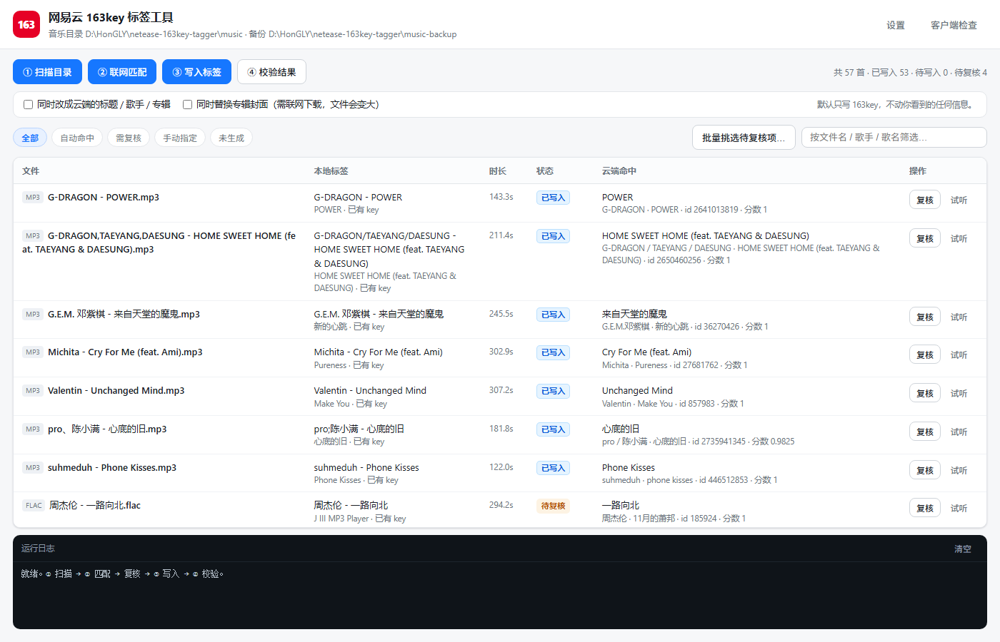

<div align="center">

# 网易云 163key 标签工具

**给本地音乐文件写入 163key，让客户端认出它们是曲库里的哪首歌**

[](https://github.com/H0NG1Y/netease-163key-tagger)
[](https://github.com/H0NG1Y/netease-163key-tagger/stargazers)
[](https://github.com/H0NG1Y/netease-163key-tagger/releases/latest)
[](https://github.com/H0NG1Y/netease-163key-tagger/releases/latest)
[](https://nodejs.org)
[](package.json)

</div>



## 项目介绍

一个仅在本机运行的 Windows 工具：扫描你的本地音乐文件，按「歌手 - 歌名」到网易云曲库匹配到对应歌曲，把 `163 key(Don't modify)` 标签写进文件里。

写对之后，客户端会把它们认成曲库里的正常歌曲 —— **本地音乐会匹配上曲名和封面，也会出现在「已下载」列表里**（前提是文件放在客户端会扫描的下载目录内，见下方说明）。

整个过程不下载音乐、不破解付费内容，只改你自己磁盘上文件的标签。

## 下载

请从 [GitHub Releases](https://github.com/H0NG1Y/netease-163key-tagger/releases/latest) 下载最新版本。

- `netease-163key-tagger-v版本号.exe`（约 89 MB）：**单文件免安装，双击即用**，目标机器不需要装 Node.js。配置与报告保存在 `%USERPROFILE%\.netease-163key-tagger`。
- 从源码运行：需要 Node.js 22 或更新版本，零 npm 依赖。

Release 同时提供 `.sha256` 和 `checksums.txt`，可用于核对下载文件的 SHA-256：

```powershell
Get-FileHash .\netease-163key-tagger-v0.3.0.exe -Algorithm SHA256
```

<details>
<summary>想用命令行？</summary>

同一个 EXE 也能当 CLI 用：

```powershell
.\netease-163key-tagger.exe --cli scan
.\netease-163key-tagger.exe --cli match
.\netease-163key-tagger.exe --cli apply --write
.\netease-163key-tagger.exe --cli verify
```

</details>

## 使用方法

1. 双击 EXE，浏览器会自动打开 `http://127.0.0.1:端口`。
2. 点「设置」，选择**音乐目录**（会被写入）和**备份目录**（会被登记为只读，工具永远不会往里写）。
3. 点「① 扫描目录」，读取每个文件的标签、时长和实际码率。
4. 点「② 联网匹配」，按歌手和歌名去曲库搜索，进度条实时显示处理到哪个文件。
5. 对拿不准的条目点「复核」，在右侧抽屉里对比候选：可以试听、看封面和时长差，也可以直接粘贴歌曲 ID 或分享链接精确查找。
6. 点「③ 写入标签」。默认只写「自动命中」的条目，其余需要你显式放行。
7. 点「④ 校验结果」，把音频区和备份逐字节比对。

想同时修正文件里显示的标题、歌手、专辑或封面，勾上对应的两个复选框（默认关闭，见下方「顺带改写文件信息」）。

## 功能

- 支持 MP3（ID3v2.3 `COMM` 帧）与 FLAC（Vorbis comment `DESCRIPTION`，并补写一份 `COMMENT` 兼容副本）
- 联网匹配采用「搜索深度 100 + 时长/专辑/曲库身份三重判据」，避免命中翻唱和伴奏
- 复核界面显示封面缩略图、正版/UGC 标记、接口与本地时长差，支持按 ID 或分享链接直接定位
- 可批量重新挑选待复核项，执行前先列出方案让你确认
- 写入优先「同尺寸原地改」：能塞进原标签空间时只改标签区，音频字节一字节不动
- 可选同时改写标题、歌手、专辑与封面（`--meta` / `--cover`）
- 所有写操作默认 dry-run，不显式确认不落盘
- 备份目录登记为只读保护，路径比较按分段进行，不会误伤同前缀的兄弟目录
- 零 npm 依赖，只用 Node 内置模块

## 关于「让客户端认成已下载」

`163key` 只是元数据标签，客户端用它知道「这个文件是曲库里的哪首歌」。它**不是**「已下载」的凭据。

客户端判断「已下载」靠的是自己数据库 `webdb.dat` 里的 `offlineTrack` 表。写入链路是：

1. 原生层扫描**客户端配置的下载目录**，把文件的 comment（即解密后的 `music:{...}` 明文）交给前端；
2. 前端按第一个冒号取前缀，解析出 songId；
3. 往 `offlineTrack` 插一行，`relativePath = 绝对路径 − 下载根`。

所以要凑齐三个条件：

| 条件 | 谁负责 |
| --- | --- |
| 文件里有正确的 163key | ✅ 本工具 |
| 文件位于客户端设置的下载根目录内 | ⬜ 需要你自己放进去 |
| 客户端触发过一次下载目录扫描 | ⬜ 重新启动客户端 |

界面右上角的「客户端检查」会**以只读方式**读取 `offlineTrack` 的行数，直接告诉你还差哪一步，不需要猜。

### 已实机验证

条件凑齐后效果是双向成立的：客户端「本地音乐」里从「歌手/专辑空白」变成匹配上曲库的歌曲（`library.dat` 的 `tid` 从空变成真实 songId，且与 163key 里的 `musicId` 完全一致），「已下载」列表里也会出现这些歌（`offlineTrack` 从 0 行变成正数）。

天然对照组：没写 key 的文件，`tid` 始终为空，也不会进 `offlineTrack`。

## 顺带改写文件信息

匹配完成后，除了写 163key，还可以把文件里你看到的信息换成云端的：

```bash
node apply.mjs apply --report out/matches.json --write --meta            # 标题/歌手/专辑
node apply.mjs apply --report out/matches.json --write --meta --cover    # 再加专辑封面
```

界面上对应两个复选框，默认都不勾；勾封面会自动勾上文字。

| 开关 | 改什么 | 代价 |
| --- | --- | --- |
| `--meta` | MP3 的 `TIT2`/`TPE1`/`TALB`/`TPE2`；FLAC 的 `TITLE`/`ARTIST`/`ALBUM`/`ALBUMARTIST` | 纯文本，几乎不改变体积 |
| `--cover` | MP3 的 `APIC` 帧；FLAC 的 `PICTURE` 块（只留一张，旧封面删除） | 需联网下载封面，文件体积会变化 |

音频数据一字节都不会动，这条有回归测试守着。

## 命令行

不想开界面也可以直接用 CLI，所有子命令都支持 `--progress <file>` 输出结构化进度。

```bash
node apply.mjs scan     --root ./music
node apply.mjs match    --root ./music
node apply.mjs apply    --report out/matches.json --dry-run
node apply.mjs apply    --report out/matches.json --write
node apply.mjs verify   --root ./music --backup ./music-backup
node apply.mjs self-test
```

`apply` 的放行阶梯：默认只写自动命中的条目；`--include-review` 放行中等置信度；`--all` 全部放行。时长不符和 UGC 冒充只有 `--all` 能绕过。

## 算法

```
163key = "163 key(Don't modify):" + base64( AES-128-ECB/PKCS#7( "music:" + 紧凑JSON ) )
```

密钥固定 16 字节，无签名、无 MAC。已用客户端真实下载的文件做双向验证：解密后重新加密，与原 Base64 逐字节一致。

字段顺序固定为：`musicId, musicName, artist, albumId, album, albumPicDocId, albumPic, bitrate, mp3DocId, duration, mvId, alias, transNames, format`

## 匹配时踩过的坑

匿名搜索是 **UGC 优先**的：翻唱、type-beat、DJ 版会挤满前 10~20 条，**授权曲库里的原唱要 20~100 名才出现**。实测 `s=简单爱 周杰伦`：

| 每次查询拉取 | 结果里真·周杰伦 |
| --- | --- |
| 10 条 | 0 条 |
| 30 条 | 1 条（第 21 条，还是现场版） |
| 100 条 | 32 条 |

所以默认搜索深度 100。挑原唱靠三条硬信号：

- **时长**：差超过 5 秒的候选独立降级，歌名歌手一字不差但时长对不上的，几乎必然是伴奏或合辑版
- **专辑**：同一录音会散落在多个精选集里，时长只差 1 毫秒，只有专辑名能挑出原版
- **曲库身份**：`artist.id === 0` 且专辑名为空的，多半是上传者冒名顶替原唱

另外还有两个容易忽略的点：客户端只读**最后一个** `COMM` 帧（key 排在空 COMM 前面会被读成空串）；`bitrate` 要写文件的实际码率，不是固定 320000。

更完整的排查记录见 [`notes/matching-pitfalls.md`](notes/matching-pitfalls.md)。

## 数据与隐私

- 只读取你指定的音乐目录，不会扫描其他位置。
- 联网只做两件事：搜索曲库、下载封面（仅在你勾选「替换封面」时）。
- 匹配报告、缓存和日志保存在程序数据目录，不会上传。
- 备份目录登记为只读保护，任何写入尝试都会直接报错。
- 默认 dry-run；实际写入需要你显式确认。
- 不修改客户端安装目录里的任何文件；「客户端检查」对数据库只读（复制到临时目录后再打开）。

> 手写客户端的 `webdb.dat` 是危险且没有必要的做法 —— 标签写对了，客户端自己会建行。

## 常见问题

**匹配率不高怎么办？**

先确认文件名是「歌手 - 歌名」格式，工具靠它做搜索。实在搜不到的，在复核抽屉里手动改关键词，或直接粘贴歌曲 ID / 分享链接。

**为什么有些文件故意不写？**

宁可漏写也不写错。遇到专辑信息不可信、艺人账号对不上、时长贴着容差边界的，工具会保留给你人工判断，不会替你拍板。

**写入后客户端还是没反应？**

检查三件事：文件是否在下载根目录内、是否完全退出过客户端（含托盘图标）再启动、标签是否真的写进去了（点「校验结果」）。

**FLAC 的 163key 写在哪个字段？**

`DESCRIPTION`（Vorbis 规范的注释字段），同时补写一份 `COMMENT` 兼容副本。这一点有旁证但没有客户端产出的真实样本，所以保留了 `--flac-field` 可切换。

**EXE 为什么这么大？**

单文件打包内置了 Node 运行时（约 89 MB），换来的是不需要安装任何东西。首次启动会把约 280 KB 的网页资源释放到临时目录，之后启动几乎瞬间完成。

## 源码结构

- `server.mjs`：本地 Web 服务，零依赖，负责把 CLI 包成界面
- `web/`：前端页面，无框架、无构建
- `apply.mjs`：CLI 入口（scan / match / apply / verify / self-test）
- `lib/163key.mjs`：163key 编解码
- `lib/tags.mjs`：ID3v2 与 Vorbis comment 读写，含时长与码率解析
- `lib/match.mjs`：文件名解析与候选打分（时长、专辑、曲库身份三重判据）
- `lib/netease-api.mjs`：曲库搜索与歌曲详情
- `test/`：四套自测（212 条断言）+ 离线假 API
- `verify/`：独立验证套件，用另一套实现交叉核对
- `notes/`：接口行为、客户端机制、二进制取证、踩坑记录、验收报告
- `build.mjs`：打包成单文件 EXE（Node SEA）

## 开发

```bash
node server.mjs          # 起本地服务（源码态）
node apply.mjs self-test # 212 条断言，全程离线
node build.mjs           # 打包 EXE（需要 Node 22+ 与联网装 postject）
```

## 免责声明

这是一个非官方工具，与网易云音乐无隶属关系，仅供个人整理本地音乐库使用。请只对你合法拥有的音乐使用，不要用于分发版权内容。接口为逆向所得，服务端变更时可能需要更新。

[English README](README.en.md)
